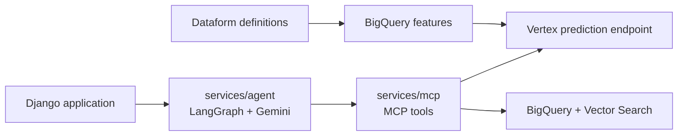

# Enterprise Clinical Copilot

Enterprise Clinical Copilot (ECC) is a full-stack AI application.  The application is designed to help healthcare professional assess unplanned readmission risk at discharge time for patients who have been admitted to the hospital for at least 24 hrs.

The application is built thoughtfully using [trusted AI Architecture](docs/architecture/00-reference-architecture.md) patterns.  While the application itself is a prototype, the software is architected to run at enterprise scale, currently deployed on GCP.

This repo represents the backend system, where the [agent](services/agent/README.md), [tools](services/mcp/README.md) and automation to create those tools lives.  The presentation layer is built using Django and is deployed through an app on my personal website.  You can view the [companion repo](https://github.com/DanHerman212/danielmherman) , to look at the source code for the web app.

The system is separated into deployable services and offline ML workflows:

```text
enterprise_clinical_copilot/
├── services/
│   ├── agent/        LangGraph + Gemini HTTP service
│   └── mcp/          MCP server, prediction tool, retrieval tool, RAG pipeline
├── mlops/            Feature encoding, training, evaluation, and model serving
├── definitions/      Dataform ELT: cohort, splits, features, and marts
├── evaluation/       Agent, retrieval, and judge workflows
├── scripts/          Operational and data-generation commands
├── tests/            Offline service and pipeline tests
└── docs/             Architecture, contracts, evaluation, and operations
```

## Runtime path



The Django application is maintained in the companion repository. It is the public
boundary for authentication, demo-cohort authorization, quota, and presentation. The
agent service owns language-model orchestration. The MCP service owns reusable prediction
and retrieval tools. 