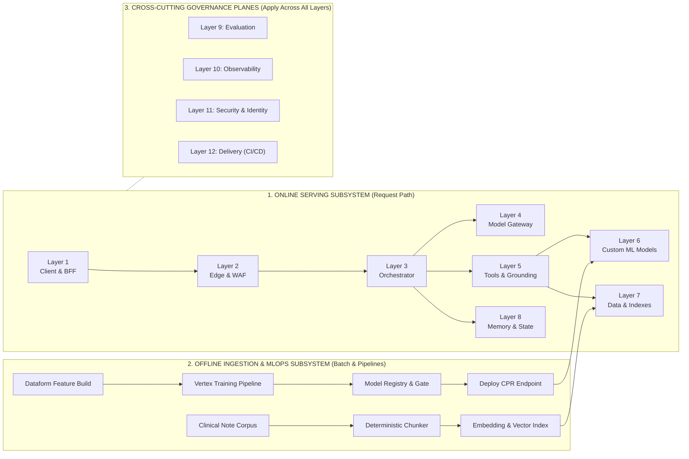

# Reference Architecture — Enterprise Clinical Copilot on Google Cloud

## 1. Architecture Purpose & Overview
The Enterprise Clinical Copilot is a full-stack, multi-turn clinical decision-support system built on Google Cloud. Its architecture is organized into **twelve distinct layers** divided across three operational planes: the **Online Serving Subsystem** (Layers 1–8), the **Offline Data & MLOps Subsystem** (feeding Layers 6–7), and four **Cross-Cutting Governance Planes** (Layers 9–12). 

This layered separation enforces a strict division of responsibilities: user interfaces render without interpreting clinical logic, the agent orchestrator remains stateless across turns, predictive and retrieval tools execute behind typed contracts, and every clinical claim is verified against source evidence before reaching the clinician.

---

## 2. System Topology Diagram

---

## 3. Core Architectural Terms

| Term | Definition |
|---|---|
| **Serving Subsystem** | The synchronous and streaming request path (Layers 1–8) that processes a clinician's question and returns a verified, cited response and visual canvas. |
| **Offline Subsystem** | The asynchronous batch pipelines that materialize analytical features, train and gate custom ML models (Layer 6), and build vector search indexes (Layer 7) without mutating live serving state. |
| **Cross-Cutting Planes** | System-wide capabilities—Evaluation (Layer 9), Observability (Layer 10), Security (Layer 11), and CI/CD Delivery (Layer 12)—that govern every service in the stack. |
| **Trust Boundary** | An explicit architectural seam where callers are authenticated, payloads are schema-validated, and untrusted inputs (user text or retrieved clinical notes) are constrained. |
| **Policy Seam** | A deterministic code boundary (such as routing, citation reconciliation, factual guardrails, or follow-up selection) executed outside the foundation model to guarantee repeatable clinical safety. |
| **Stateless Compute** | A service design where no session state is retained in process memory between requests, allowing horizontal autoscaling and zero-loss instance restarts. |

---

## 4. Context in the Stack: The Twelve Layers

Layers 1 through 8 form the runtime request path and its backing data dependencies. Layers 9 through 12 govern quality, telemetry, security, and release automation across the entire repository.

| Layer | Name | Primary Responsibility | Google Cloud Reference Standards (MUSTs) | Primary Stack Components |
|---|---|---|---|---|
| **1** | **Client & BFF** | Render the clinical workspace, collect user input, authenticate sessions, enforce user quotas, and relay SSE streams. | Frontend never calls models or holds secrets; stateless API; streaming support; conversation state externalized. | Browser UI (A2UI), Django Backend-for-Frontend (Cloud Run) |
| **2** | **Edge & Front Door** | Terminate TLS, filter malicious traffic, enforce per-IP rate limits prior to authentication, and propagate trace IDs. | External Application Load Balancer; Cloud Armor WAF/throttling; `run.app` direct ingress restricted. | Global External ALB, Cloud Armor, Cloud DNS, Certificate Manager |
| **3** | **Orchestrator** | Own the turn lifecycle: route slash commands vs. ReAct loops, bound tool/model steps, run post-model guardrails, and assemble A2UI presentations. | Prompt, chain, tool wiring, and model pin versioned as one artifact; explicit loop step caps; deterministic post-processing. | Starlette Agent Service, LangGraph (`services/agent/` on Cloud Run) |
| **4** | **Model Runtime & Gateway** | Provide a single policy door to the foundation model: enforce model pins, timeouts, thinking budgets, safety thresholds, retries, and token accounting. | Managed model runtime; bounded timeouts and retries; thinking budget control; explicit safety screening thresholds. | Vertex AI (`gemini-3.1-flash-lite`), Model Gateway Boundary |
| **5** | **Tools & Grounding** | Expose patient-scoped retrieval, literature search, and risk prediction capabilities behind strict input/output schemas. | MCP protocol with typed schemas both ways; `< 5` primitive parameters per tool; semantic isolation inside queries; delimiter escaping. | FastMCP Server (`services/mcp/` on Cloud Run), NCBI E-utilities |
| **6** | **Custom ML Models** | Train, gate, register, and serve the custom 30-day readmission classifier and TreeSHAP attribution engine. | Automated training pipeline with hard quality gates; Model Registry lineage; immutable container digests; blue/green endpoint promotion. | Vertex AI Pipelines (KFP), XGBoost CPR Container, Vertex Endpoints |
| **7** | **Data & Indexes** | Maintain read-only serving tables, clinical note corpora, deterministic section chunks, and approximate nearest-neighbor vector indexes. | Live requests never mutate data; identical embedding space at ingest and serve time; data fingerprints recorded in manifests; recall-gated index promotion. | BigQuery, Dataform, Vertex AI Vector Search, Cloud Storage |
| **8** | **Memory & Session State** | Persist multi-turn conversation history, enforce retention windows, and structurally replay prior turns and tool calls into the stateless agent. | Stateless agent compute; externalized session store; structural tool-call replay; automated retention sweeps. | Cloud SQL (PostgreSQL), Structural Replay Engine, Cloud Run Jobs |
| **9** | **Evaluation** | Measure clinical narrative quality, grounding, citation fidelity, and adversarial resilience against frozen rubrics and datasets. | Stratified golden and adversarial datasets; LLM-as-judge isolated from model under test; exact + judged criteria; pre-release gates. | Two-Tier Evaluation Harness (`evaluation/`), Langfuse Datasets |
| **10** | **Observability** | Emit durable structured execution logs and distributed traces linking every answer to its exact code, model, and tool lineage. | End-to-end trace propagation; durable log archive separated from browsing surface; token, latency, and error telemetry; zero PII in logs. | Cloud Logging (Archive), Self-Hosted Langfuse v4 + ClickHouse |
| **11** | **Security & Identity** | Enforce least-privilege IAM, workload identity, service-to-service OIDC authentication, data minimization, and prompt-injection defenses. | Per-service accounts; workload identity; untrusted input framing; prompts versioned as code; supply-chain digest pinning. | Cloud IAM, Secret Manager, OIDC Identity Tokens, Delimiter Guards |
| **12** | **Delivery (CI/CD)** | Automate container builds, database migrations, cohort seeding, staged no-traffic deployments, and traffic promotion. | Automated build triggers; config-as-code; migrations executed prior to traffic promotion; immutable image digests; rollback procedures. | Cloud Build (`cloudbuild.yaml`), Artifact Registry, Cloud Run Revisions |