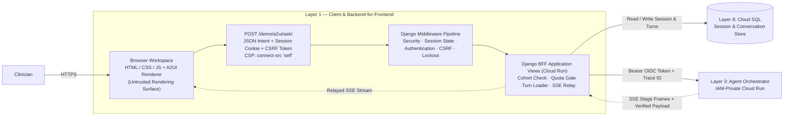

# Layer 1 — Client & Backend-for-Frontend (BFF)

## 1. Layer Definition & Purpose

The Client layer comprises the clinician-facing browser workspace and the Django Backend-for-Frontend (BFF) web server that serves and mediates it. Because everything delivered to a browser can be inspected, modified, or replayed by the end user, the browser is treated as an untrusted rendering surface. It holds no credentials, makes no clinical or citation-mapping decisions, and communicates exclusively with the Django BFF.

The Django BFF is the system's sole public application surface. It leverages Django's built-in middleware pipeline (`SessionMiddleware`, `AuthenticationMiddleware`, `CsrfViewMiddleware`, and `SecurityMiddleware`) alongside brute-force lockout protection to manage authenticated user state and request security before view logic ever executes. Beyond middleware enforcement, the BFF governs per-user request quotas, orchestrates externalized conversation persistence, mints short-lived Google Cloud OIDC identity tokens, and relays Server-Sent Events (SSE) between the private Agent service and the browser.

## 2. Architecture & Boundary Diagram

## 3. Core Engineering Terms

| Term | Definition |
| ----- | ----- |
| **Backend-for-Frontend (BFF)** | A dedicated server tier that serves a single user interface and mediates all communication between the untrusted browser and private internal microservices. |
| **Django Middleware Pipeline** | A layered series of request/response hooks (`SessionMiddleware`, `AuthenticationMiddleware`, `CsrfViewMiddleware`, `AxesMiddleware`) that resolve session state, verify user identity, and enforce security headers before any request reaches application views. |
| **Session & Authentication State** | Server-backed identity management where the browser holds only an opaque `HTTPS`-only session cookie, while the authoritative session record and authenticated user context (`request.user`) are resolved from the database on every request. |
| **Rendering vs. Interpretation** | The architectural rule that the browser only *renders* pre-resolved data structures (`sources[n]`, A2UI component trees, `follow_ups`), while the backend owns all *interpretation* (citation resolution, section matching, and clinical formatting). |
| **Content Security Policy (CSP)** | An HTTP response header (`connect-src 'self'`) enforced by the browser that restricts network requests strictly to the originating Django server, preventing direct calls to external endpoints. |
| **OIDC Identity Token** | A short-lived, cryptographically signed JWT minted by the Django BFF via the Cloud Run metadata server (`audience = agent_url`) to authenticate service-to-service calls to the IAM-private Agent. |
| **Server-Sent Events (SSE)** | A unidirectional HTTP streaming protocol (`text/event-stream`) used to push real-time execution stage updates (`planning`, `tool`, `result`, `verify`) to the browser prior to the final verified answer frame. |

## 4. Context in the Stack

* **Upstream (Edge — Layer 2):** Public internet traffic arrives at the Django BFF through Layer 2 (External Application Load Balancer and Cloud Armor WAF, or Cloud Run domain mapping), which terminates TLS and stamps the inbound `X-Cloud-Trace-Context` header.

* **Internal Boundary (Browser to Django Middleware to BFF Views):** Every inbound request from the browser first traverses Django's middleware stack, which enforces HTTPS/HSTS headers, resolves the opaque session cookie against the database, attaches the authenticated user identity, verifies CSRF tokens on `POST` requests, and blocks repeated failed login attempts. Once admitted by middleware, the BFF view validates the closed-set JSON payload (`question` or `chip`, `hadm_id`, and optional `conversation_id`) and rejects unknown fields before any quota or compute is consumed.

* **Downstream to State (Memory — Layer 8):** While Django's session middleware manages authentication state across requests, the BFF application layer remains stateless in process memory. Before calling the Agent, the BFF validates cohort authorization, claims a user quota credit on new conversations, and retrieves the conversation's prior turn history (`replay_turns`) from Cloud SQL.

* **Downstream to Compute (Orchestrator — Layer 3):** The BFF attaches a per-request OIDC `Authorization: Bearer` token and forwards the `X-Cloud-Trace-Context` header to the Agent's `/ask` or `/ask/stream` endpoint. As SSE progress frames arrive, the BFF relays them asynchronously to update the UI status line, and persists the completed turn only when the terminal verified payload arrives.

* **Architectural Boundaries (What Layer 1 Refuses to Own):** Layer 1 never constructs system prompts, never parses or heals malformed citations in client-side scripts, never calls foundation models or MCP tools directly, and never exposes internal stack traces or cloud metadata to the browser.