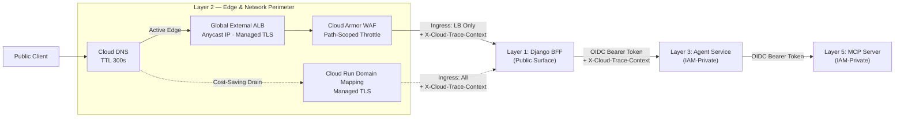

# Layer 2 — Edge & Front Door

## 1. Layer Definition & Purpose

The Edge layer is the outermost network perimeter where public internet traffic first meets the system prior to application-level authentication. Its primary responsibility is to terminate TLS connections, enforce network-level ingress restrictions, block volumetric or malicious traffic at the perimeter, and stamp every inbound request with a global distributed trace identifier before any application compute or database resources are consumed.

To balance enterprise perimeter security with serverless cost efficiency, this layer is architected in Terraform with a dual-switch topology (`edge_enabled` and `dns_points_at_edge`). When the full perimeter is active, a Global External Application Load Balancer and Cloud Armor Web Application Firewall (WAF) front the Django Backend-for-Frontend (BFF), path-scoped rate throttling protects authentication and inference routes, and Cloud Run's direct `run.app` URL is disabled. During idle demonstration windows, traffic drains cleanly to Cloud Run's native domain mapping with zero dropped connections.

## 2. Architecture & Boundary Diagram

## 3. Core Engineering Terms

| Term | Definition |
|---|---|
| **Global External Application Load Balancer (ALB)** | Google Cloud's globally distributed Layer 7 proxy that terminates HTTP/HTTPS connections at the edge using a single static anycast IP and a Certificate Manager TLS map. |
| **Serverless NEG (Network Endpoint Group)** | A backend abstraction that connects a Google Cloud Load Balancer directly to a serverless Cloud Run service without managing virtual machine instances or ports. |
| **Cloud Armor Throttle** | A stateless edge security policy that rejects requests exceeding defined per-IP thresholds with HTTP `429` on sensitive routes (`/accounts/login` and `/demo/a2ui/ask`) without banning static asset loads. |
| **Cloud Run Ingress Control** | A network-layer enforcement policy (`internal-and-cloud-load-balancing`) that restricts a Cloud Run service to accept traffic exclusively from the Google Cloud Load Balancer, causing direct requests to the default `*.run.app` hostname to return HTTP `404`. |
| **Two-Phase DNS Drain** | An operational transition pattern governed by separating infrastructure existence (`edge_enabled`) from DNS routing (`dns_points_at_edge`), allowing both serving paths to answer concurrently for one full DNS TTL window (`300s`) during bring-up or teardown. |
| **Distributed Trace Context** | A standardized HTTP header (`X-Cloud-Trace-Context`) stamped at the Google Cloud edge on every inbound request and forwarded across service hops to correlate logs and spans end-to-end. |

## 4. Context in the Stack

* **Upstream (Public Internet & DNS):** External users resolve the application domain via Cloud DNS (`300s` TTL). Certificate Manager maintains persistent DNS authorizations and a pre-provisioned certificate map so TLS termination is immediately available whenever the load balancer is stood up.

* **Internal Boundary (Perimeter Filtering & Rate Limiting):** Because per-user application quotas can only be enforced *after* a user identity is resolved in Layer 1, only Layer 2 can bound unauthenticated or anonymous traffic. Cloud Armor evaluates inbound requests at the edge and applies path-scoped throttling (`30 req/min/IP` on `/accounts/login` and `60 req/min/IP` on `/demo/a2ui/ask`) while allowing high-concurrency static JavaScript and CSS module fetches to pass unimpeded.

* **Downstream to Application (Client & BFF — Layer 1):** Admitted requests are routed via the Serverless NEG to the Django BFF container with the client's real IP address preserved and `X-Cloud-Trace-Context` attached. When the load balancer is active, the BFF's Cloud Run ingress setting is locked to `internal-and-cloud-load-balancing`, rendering the default `run.app` URL unreachable from the public internet.

* **Downstream Service-to-Service Isolation (Layers 3 & 5):** Internal microservices—the Agent Orchestrator (Layer 3) and the MCP Tool Server (Layer 5)—are never exposed to the public edge. They are protected by Cloud Run IAM invoker policies requiring short-lived, audience-scoped OIDC identity tokens minted by their immediate upstream caller (`website-sa` $\rightarrow$ `agent` $\rightarrow$ `mcp-server`).

* **Architectural Boundaries (What Layer 2 Refuses to Own):** Layer 2 owns network admission and volumetric IP throttling, not application-level identity or business authorization. It does not manage user sessions, per-user credit quotas, cohort access rules, or payload schema validation, all of which belong to Layer 1 and Layer 3.