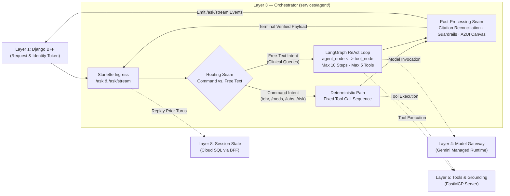

# Layer 3 — Orchestrator (The Chain)

## 1. Layer Definition & Purpose

The Orchestrator layer is the core execution engine that governs what happens between a validated clinician request and a verified response. It owns the end-to-end turn lifecycle: assembling prompts from code templates and request data, selecting execution paths (deterministic fast paths versus iterative ReAct reasoning loops), binding and executing tools via typed protocols, bounding execution cost and loop recursion, enforcing factual guardrails against retrieved evidence, and composing the final user-facing presentation. As an architectural principle, the orchestrator is stateless across invocations—it holds no session state in memory, allowing any container instance to process any turn without affinity—and treats the prompt, chain logic, tool bindings, and model pin as a single versioned deployable unit.

## 2. Architecture & Boundary Diagram

## 3. Core Engineering Terms

| Term | Definition |
|---|---|
| **Orchestrator** | The state machine and execution controller that coordinates prompt assembly, tool dispatch, foundation model interactions, and response verification. |
| **Deterministic Fast Path** | A non-stochastic execution pipeline that routes predefined clinical commands (such as `/ehr` or `/risk`) through fixed tool sequences without relying on model-driven routing. |
| **ReAct Loop** | An iterative reasoning pattern (*Reason + Act*) where a model repeatedly alternates between emitting thoughts, requesting tool calls, and observing results until a terminal answer condition is met. |
| **Superstep Cap** | A hard constraint on the maximum number of state graph node transitions (e.g., 10 supersteps) and tool calls per turn (e.g., 5 calls) to prevent runaway execution latency and token spend. |
| **Policy Seam** | A deterministic, pure-function code boundary (e.g., citation verification, factual guardrails, follow-up generation) executed outside the model loop to ensure predictable safety invariants. |
| **Delimiter Guard** | Explicit structural framing (e.g., `<tool_result name="...">...</tool_result>`) applied to external tool data with escaped closing tags to prevent untrusted retrieved text from being interpreted as instructions. |
| **Structural Replay** | Reconstructing prior conversation turns as message structures with original tool calls and results framed as data, preserving context without altering prompt instruction boundaries. |

## 4. Context in the Stack

* **Upstream (Client & BFF — Layer 1):** The orchestrator receives inbound authenticated requests from the Django BFF over private Cloud Run networking (`POST /ask` or `POST /ask/stream`). Each request delivers user intent (`question` or `chip`), encounter identifier (`hadm_id`), an optional prior-turn history array (`turns`), and distributed trace headers. The orchestrator emits either a single validated response envelope or Server-Sent Events containing progress stages followed by the terminal verified payload.
* **Downstream to Foundation Model (Model Runtime & Gateway — Layer 4):** When executing reasoning turns, the orchestrator invokes the foundation model through a managed gateway boundary. It supplies the system prompt, conversation history, and tool declarations, while receiving model decisions (content text or requested tool calls) governed by bounded timeouts and thinking budgets.
* **Downstream to Tools (Tools & Grounding — Layer 5):** The orchestrator invokes external capabilities (clinical note retrieval, laboratory trends, readmission scoring, and literature search) strictly over the Model Context Protocol (MCP) using typed schemas. Tool responses are treated as untrusted data, size-capped, and wrapped in structural delimiters before re-entering model context.
* **Interaction with State (Memory & Session State — Layer 8):** The orchestrator maintains zero persistence between requests. For multi-turn interactions, the upstream caller injects historical turns into the request envelope; the orchestrator structurally reconstructs these turns as prior message pairs and re-derives or replays their tool evidence to maintain context.
* **Architectural Boundaries (What Layer 3 Refuses to Own):** Layer 3 does not own HTTP session cookies or user quotas (owned by Layer 1), network-level rate limits (owned by Layer 2), model serving and quota management (owned by Layer 4), tool implementation and indexing logic (owned by Layers 5, 6, and 7), or long-term storage and retention schedules (owned by Layer 8).