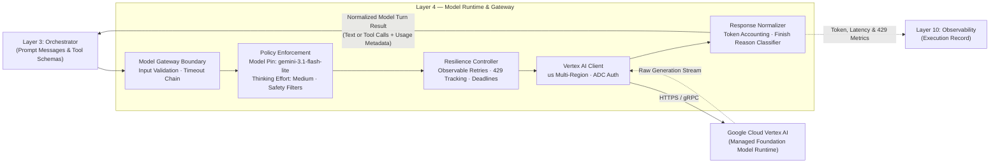

# Layer 4 — Model Runtime & Gateway

## 1. Layer Definition & Purpose

The Model Runtime & Gateway layer is the single, centralized policy boundary through which all foundation model interactions pass. It encapsulates model consumption by enforcing immutable model revision pinning, per-call execution deadlines, thinking budgets, safety screening thresholds, observable rate-limit retry policies, and granular token accounting. By treating the foundation model as an external managed dependency rather than an embedded application component, this layer shields upstream orchestrators from provider-specific SDK variations, prevents unobserved throttling or cost overruns, and ensures that model changes occur under verifiable evaluation rather than silent platform defaults.

## 2. Architecture & Boundary Diagram

## 3. Core Engineering Terms

| Term | Definition |
|---|---|
| **Model Gateway** | The unified programmatic interface that mediates all outbound model invocations, applying operational bounds, retries, and screening before requests reach the provider. |
| **Managed Model Runtime** | A fully managed infrastructure service (such as Google Cloud Vertex AI) that hosts and scales the foundation model, handling physical compute, hardware acceleration, and base availability. |
| **Model Pinning** | The practice of binding execution to an exact, dated model revision in version control rather than a floating alias, preventing silent behavioral or screening drift. |
| **Thinking Budget** | A configurable constraint governing internal reasoning tokens (e.g., reasoning effort level) allocated to reasoning-capable models prior to emitting response text. |
| **Finish Reason** | The provider-reported classification explaining why text generation concluded (e.g., `STOP`, `MAX_TOKENS`, `SAFETY`), used to separate normal completion from truncation or policy refusals. |
| **Safety Screening Threshold** | Explicitly declared confidence filters across harm categories (such as harassment, hate speech, dangerous content) evaluated on prompts and candidate completions. |
| **Token Accounting** | The exact measurement and attribution of input, output, thinking, and cached tokens consumed during each invocation, exported to durable telemetry. |

## 4. Context in the Stack

* **Upstream (Orchestrator — Layer 3):** The orchestrator calls the Model Gateway whenever an agent node requires foundation model inference. The orchestrator supplies system instructions, replayed dialogue messages, and tool schema declarations. The gateway validates that the request respects configured token and timeout limits, dispatches the call, and returns a normalized completion object containing either synthesized text or validated tool-call requests.
* **Downstream to Provider (Managed Runtime — Vertex AI):** The gateway connects to Google Cloud Vertex AI using Application Default Credentials (ADC) targeting the `us` multi-region endpoint. It manages network-level interactions, enforces the 60-second per-call deadline, and wraps execution in an observable backoff loop to capture throttling (`429 Too Many Requests`) events.
* **Outbound to Telemetry (Observability — Layer 10):** Every completed or failed model turn emits structured telemetry into the execution record. The gateway logs the requested versus served model version, wall-clock duration, input/output/thinking token counts, retry attempts, and any active safety category flags, ensuring complete auditability for Layer 10.
* **Architectural Boundaries (What Layer 4 Refuses to Own):** Layer 4 does not author system prompts or clinical questions (owned by Layer 3), does not execute or validate tool payloads (owned by Layer 5), does not manage user sessions or conversation history (owned by Layer 8), and does not apply clinical factual guardrails against retrieved evidence (owned by Layer 3).