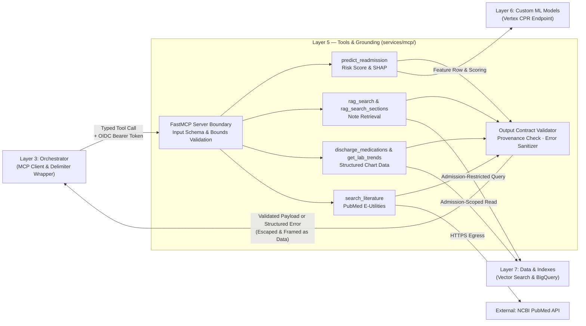

# Layer 5 — Tools & Grounding

## 1. Layer Definition & Purpose

The Tools & Grounding layer is the exclusive boundary through which the system accesses external evidence: patient clinical notes, structured laboratory panels, readmission risk predictions, and biomedical literature. Exposed over the Model Context Protocol (MCP), this layer enforces strict input and output schema contracts, guarantees patient-level semantic isolation inside every data query, and converts raw operational exceptions into safe, structured error codes. Because retrieved clinical notes and external records originate outside the system's instruction hierarchy, this layer treats all tool outputs as untrusted data—validating payload structures, bounding passage lengths, and escaping structural delimiters before returning evidence to the orchestrator.

## 2. Architecture & Boundary Diagram

## 3. Core Engineering Terms

| Term | Definition | 
| ----- | ----- | 
| **Model Context Protocol (MCP)** | A standardized wire protocol that exposes callable tools with typed JSON schemas over streamable HTTP or standard I/O, decoupling tool discovery and execution from the agent runtime. | 
| **Symmetric Schema Contract** | The enforcement of explicit types on both sides of a tool call: an input schema that constrains model arguments at the boundary, and a declared output schema validated by both the server and client. | 
| **Semantic Isolation** | Enforcing patient-level data scoping by passing the encounter identifier (`hadm_id`) directly into the vector index restriction filter and database query predicates, followed by a post-fetch ownership verification. | 
| **Untrusted Tool Output** | The security posture that treats retrieved clinical prose and external API payloads as potentially adversarial data, requiring strict size caps and delimiter escaping before prompt injection. | 
| **Graceful Structured Failure** | Returning operational, validation, or missing-subject faults as typed data payloads (`{"error": code, "message": ...}`) rather than unhandled exceptions or raw stack traces. | 
| **Subject Existence Verification** | Distinguishing between an authorized admission that genuinely has zero matching records (`returned: 0`) and an unrecognized admission identifier (`unknown_patient`), preventing hallucinated empty-chart claims. | 
| **Focused Toolset** | Designing discrete, single-purpose tools with fewer than five primitive parameters rather than monolithic multi-mode functions, reducing model tool-selection ambiguity. | 

## 4. Context in the Stack

* **Upstream (Orchestrator — Layer 3):** The orchestrator's MCP client connects to the IAM-private MCP server using a short-lived Google OIDC identity token and a bounded per-tool timeout (`100s`). It discovers registered tools, cleans schema metadata for model compatibility, dispatches tool calls, unwraps and validates the returned payload against the shared output contract, and wraps the result in `<tool_result>` tags with angle-bracket delimiter escaping.

* **Downstream to Custom ML (Custom Models — Layer 6):** When `predict_readmission` is invoked, Layer 5 fetches the patient's 49-feature vector from the analytical store, orders and keys it against the active model bundle's manifest, and calls the Vertex AI Custom Prediction Routine (CPR) endpoint to obtain the calibrated readmission probability, threshold decision, and TreeSHAP attributions.

* **Downstream to Storage & Indexes (Data & Indexes — Layer 7):** Retrieval and structured chart tools query Vertex AI Vector Search and BigQuery read-only tables. Every query embeds the shared vector-space constants and restricts execution to the requested `hadm_id` at query time; resolved rows are re-verified against the requested admission before leaving the tool boundary.

* **External Egress (Biomedical Literature):** The `search_literature` tool is the only component permitted external internet egress, querying NCBI PubMed E-utilities with zero patient identifiers on the wire.

* **Architectural Boundaries (What Layer 5 Refuses to Own):** Layer 5 does not decide *when* or *how often* a tool is called (owned by Layer 3), does not construct or mutate vector indexes or feature tables (owned by Layer 7), does not train or register predictive models (owned by Layer 6), and does not synthesize prose or format A2UI visual components (owned by Layer 3).