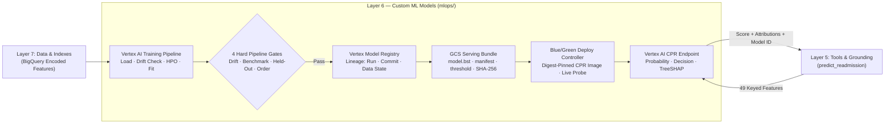

# Layer 6 — Custom ML Models

## 1. Layer Definition & Purpose

The Custom ML Models layer governs the end-to-end lifecycle of predictive models trained specifically for this system—principally the 30-day unplanned hospital readmission classifier and its exact TreeSHAP attribution engine. Unlike foundation models consumed as stateless external APIs, a custom-trained model is a stateful engineering artifact whose validity depends on the reproducibility of its training pipeline, the independence of its evaluation gates, and the cryptographic integrity of its serving bundle. This layer enforces a strict MLOps contract: models are produced exclusively by version-controlled pipelines with non-overridable quality gates, registered with full data and code lineage in the platform registry, packaged with SHA-256 verified feature manifests and operating thresholds, and promoted to production endpoints via zero-downtime blue/green verification.

## 2. Architecture & Boundary Diagram

## 3. Core Engineering Terms

| Term | Definition |
| ----- | ----- |
| **Custom Prediction Routine (CPR)** | A containerized serving runtime deployed on Vertex AI Endpoints that encapsulates model loading, SHA-256 bundle verification, input feature validation, forward-pass scoring, and TreeSHAP attribution in a single atomic request. |
| **Serving Bundle** | The immutable, versioned directory of artifacts required to serve a trained model—comprising the native booster (`model.bst`), the 49-feature order and grouping manifest (`manifest.json`), the calibrated operating threshold (`threshold.json`), gate metrics, and `checksums.json`. |
| **Hard Pipeline Gate** | An automated validation step inside the training DAG whose threshold is compiled into code or a versioned container artifact (never a runtime submission parameter) that aborts pipeline execution before registration if quality degrades. |
| **ML Metadata Lineage** | The platform-recorded directed graph linking a registered model version back to the exact pipeline execution run, Git commit revision, container image digest, and source table state that produced it. |
| **TreeSHAP Attribution** | Exact per-feature Shapley additive explanations computed during inference and aggregated into clinical parent groups to quantify how each patient factor shifts readmission risk relative to the cohort baseline. |
| **Content-Addressed Image Digest** | An immutable container identifier (`@sha256:...`) used in place of mutable tags (such as `:latest`) to guarantee that the exact bytes tested during build are the bytes executing on the prediction endpoint. |
| **Blue/Green Endpoint Promotion** | A deployment strategy that mounts a new model revision on a live endpoint at `0%` traffic, verifies its health and self-reported model identity via a synthetic probe, shifts traffic to `100%`, and only then retires the predecessor. |

## 4. Context in the Stack

* **Upstream from Data (Data & Indexes — Layer 7):** During offline training, the pipeline ingests the materialized feature table from BigQuery (`analytics_dataset_encoded`), captures its modification timestamp and row counts into the lineage manifest, and verifies patient-level split disjointness so no patient's admissions straddle training and evaluation partitions. During online serving, Layer 5 fetches the single-admission 49-feature row from Layer 7 using the exact feature contract exported by this layer.

* **Internal Lifecycle (Training, Gating & Registration):** The 12-step Vertex AI Pipeline fits an unweighted logistic XGBoost classifier and enforces four non-overridable gates prior to registration: training-to-validation covariate drift (`<= 20%` drifted columns), default-hyperparameter superiority over the published HOSPITAL clinical baseline (`+0.01` AUCPR), held-out test split superiority and generalization stability (`<= 0.02` AUCPR drop from validation), and mandatory completion of subgroup fairness and explainability audits. Passing runs write a SHA-256 verified bundle to Cloud Storage and register a `stage=final` entry in Vertex AI Model Registry.

* **Online Serving Boundary (Tools & Grounding — Layer 5):** The `predict_readmission` MCP tool invokes the Vertex AI CPR endpoint by sending a dictionary keyed explicitly by the 49 declared feature names rather than a fragile positional array. The CPR container rejects unknown keys, missing features, or non-finite values, executes a single pass to compute the calibrated probability, threshold decision (`>= 0.11`), and top 10 parent-grouped TreeSHAP factors, and stamps its own `deployed_model_id` and `model_version` onto the response payload so every prediction is provably attributable.

* **Architectural Boundaries (What Layer 6 Refuses to Own):** Layer 6 does not own raw clinical note chunking or vector indexing (owned by Layer 7), does not expose endpoints directly to the agent orchestrator or browser (mediated strictly through Layer 5's MCP contract), does not translate feature keys into prose narratives or UI charts (owned by Layer 3), and does not permit manual or mutable-tag image deployments to take serving traffic.