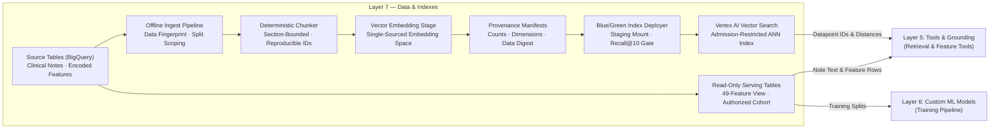

# Layer 7 — Data & Indexes

## 1. Layer Definition & Purpose

The Data & Indexes layer owns the persistent evidentiary substrate from which the system reasons and answers: the relational analytical feature tables, the clinical discharge note corpus, the approximate nearest-neighbor vector index, and the offline ingestion pipelines that materialize them. Its defining architectural invariant is that state in this layer **outlives individual code deployments and is strictly read-only on the serving path**. Live user requests never insert, mutate, or delete analytical rows or vector embeddings. Every derived artifact—whether a chunk manifest, an embedding cache, or a deployed vector index—carries a cryptographic fingerprint of the source data state and the exact embedding space parameters that produced it, ensuring that serving queries and offline indexes never drift into incompatible coordinate spaces and that no candidate index reaches production without passing an automated recall gate.

## 2. Architecture & Boundary Diagram

## 3. Core Engineering Terms

| Term | Definition |
|---|---|
| **Read-Only Serving Substrate** | The architectural guarantee that online request paths only read from analytical tables and vector indexes, preventing live traffic from corrupting evidence or introducing unversioned state. |
| **Deterministic Section Chunking** | A pure-function text segmentation algorithm that divides clinical notes along canonical section headings into fixed-budget passages with reproducible identifiers (`{note_id}_{section}_{ordinal}`), allowing serving paths to re-derive exact passage text without maintaining a duplicate chunk database. |
| **Single-Sourced Embedding Space** | The shared code constant defining the embedding model, dimensionality, and task type imported identically by both offline ingestion and online query encoding so vectors remain mathematically comparable. |
| **Data Fingerprint** | A deterministic digest computed from source table modification timestamps and row counts, recorded inside every pipeline manifest to bind cached embeddings and built indexes to an exact version of the underlying data. |
| **Admission Restriction Attribute** | A metadata namespace (`hadm_id`) attached to every vector datapoint at index build time that confines similarity ranking strictly to a single patient's records inside the index query itself. |
| **Recall-Gated Blue/Green Promotion** | A deployment control that mounts a newly built vector index under a staging identifier, executes a live retrieval evaluation job (`recall@10` and `empty_result_rate`) against the candidate, and promotes it to serve traffic only if quality thresholds are met. |
| **Authorized Cohort Derivation** | The principle that the admission allowlist governing application access is programmatically derived from the exact set of admissions present in the served feature and note tables, preventing split or fixture divergence. |

## 4. Context in the Stack

* **Offline Ingestion & Provenance Boundary:** All writes to Layer 7 occur via deliberate offline batch pipelines (Dataform SQL definitions for analytical feature engineering and Vertex AI Pipelines for RAG ingestion). At submission time, the ingestion pipeline computes a source data fingerprint and verifies that any reused embedding cache matches both the data fingerprint and the current embedding model constants. It chunks narrative sections deterministically, writes provenance manifests to Cloud Storage, and builds the vector index with a hard guard preventing restricted corpora from deploying to public endpoints.

* **Promotion & Quality Gating:** Attaching an index to a serving endpoint is governed by a single gated deployment path. The deployer locates the build manifest for the candidate index, mounts the candidate alongside the active production index under a staging deployment ID, and runs the retrieval recall harness against the staging endpoint. If the measurement is absent or falls below configured recall thresholds, the candidate is undeployed automatically while the live index continues serving uninterrupted.

* **Upstream to Tools & Grounding (Layer 5):** At request time, Layer 5 queries this layer through two read-only channels: similarity search against Vertex AI Vector Search (passing `hadm_id` as an in-query restriction filter and importing the single-sourced embedding definition) and direct analytical lookups against BigQuery for full note text, structured lab trends, discharge medications, and the 49-feature vector. Returned vector datapoint IDs are resolved back to exact clinical prose by re-running the deterministic chunker over the patient's note row.

* **Upstream to Custom ML (Layer 6):** Layer 7 supplies the split-scoped training and validation tables (`analytics_dataset_encoded`) to the Layer 6 training pipeline while strictly excluding training-split admissions from the demonstration serving index.

* **Architectural Boundaries (What Layer 7 Refuses to Own):** Layer 7 does not expose database or vector endpoints directly to the orchestrator or browser (always mediated by Layer 5), does not validate tool input schemas or escape prompt delimiters (owned by Layer 5), does not fit predictive weights or calibrate risk thresholds (owned by Layer 6), and does not store mutable user session transcripts (owned by Layer 8).