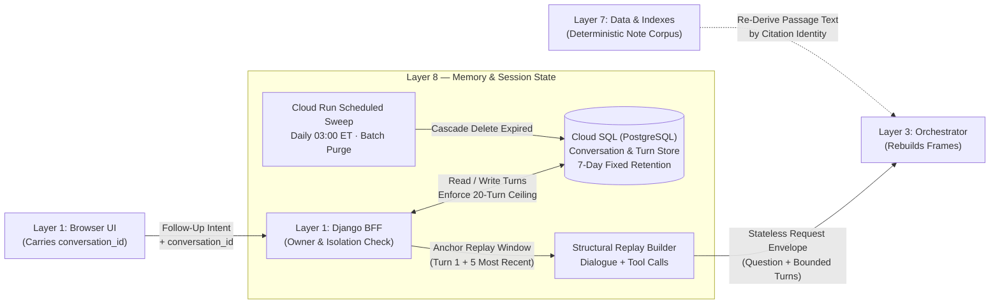

# Layer 8 — Memory & Session State

## 1. Layer Definition & Purpose

The Memory & Session State layer owns the persistence, isolation, retention lifecycle, and structural replay of multi-turn clinical conversations. Because the Layer 3 Agent Orchestrator is strictly stateless across requests—allowing horizontal scaling and zero-loss instance restarts—conversational continuity must be externalized to a durable store and explicitly supplied on each follow-up turn. This layer enforces three critical clinical and privacy invariants: every conversation is immutably pinned to a single patient admission (`hadm_id`) at creation, raw clinical note text is never duplicated into the transactional session database (citations store only passage identities and are deterministically re-derived from the corpus on replay), and all persisted holdings are governed by automated, scheduled retention sweeps.

## 2. Architecture & Boundary Diagram

## 3. Core Engineering Terms

| Term | Definition |
| ----- | ----- |
| **Externalized Session State** | Storing conversation transcripts and metadata in a durable database outside the agent process so any stateless compute instance can serve any turn without session affinity. |
| **Subject Pinning** | The invariant that a conversation is bound to a single `hadm_id` when opened and re-verified on every turn, preventing implicit cross-patient context contamination. |
| **Structural Replay** | Reconstructing prior turns as native framework message sequences—user questions, assistant tool-call requests, delimited `<tool_result>` blocks, and assistant answers—rather than concatenating raw transcript prose into the system prompt. |
| **Retrieval Re-Resolution** | Storing only citation identities and tool arguments in the session database and deterministically recomputing retrieved note passages from the read-only corpus during replay, keeping clinical note text out of the transactional store. |
| **Non-Rederivable Payload Persistence** | Persisting tool outputs that depend on point-in-time model endpoint state (such as calibrated readmission probabilities and TreeSHAP attributions) alongside the turn so historical scores do not shift on replay. |
| **Anchor Replay Window** | The context-pruning policy for long threads that transmits the first turn (the clinical baseline) together with the five most recent turns (`max 6` turns total) to preserve initial encounter orientation. |
| **Scheduled Retention Sweep** | A batch purge job triggered by Cloud Scheduler that deletes expired conversations by creation timestamp (`168 hours`) in bounded transactions rather than relying on lazy read-time expiration. |

## 4. Context in the Stack

* **Upstream from Client & BFF (Layer 1):** The browser holds only the `conversation_id` handle and its rendered view state; it is never permitted to submit historical turns directly (`turns` is rejected at the public BFF boundary). When a clinician submits a follow-up question, the Django BFF verifies that the `conversation_id` belongs to the authenticated user, has not exceeded its 7-day retention window or 20-turn ceiling, and matches the pinned `hadm_id`. Opening a conversation claims a single user quota credit; subsequent follow-up turns within that conversation consume no additional credits up to the turn ceiling.

* **Downstream to Orchestrator (Layer 3):** The BFF loads the stored turns from Cloud SQL, applies the Anchor Replay Window (Turn 1 plus up to the 5 most recent turns, capped at 5 tool calls per turn), and forwards them in the closed `turns` contract to the stateless Agent. Inside Layer 3, the replay engine reconstructs each historical tool call and passes its output through the exact same `<tool_result>` wrapper and angle-bracket delimiter guard used for live tool calls, ensuring replayed evidence can never cross into the instruction channel.

* **Interaction with Data & Indexes (Layer 7) & Observability (Layer 10):** Because Layer 8 forbids storing raw discharge note prose in Cloud SQL, each stored turn records only citation identifiers, tool arguments, non-rederivable prediction payloads, the composed A2UI presentation metadata, and provenance stamps (`model`, `code_revision`, `langfuse_trace_id`, `guardrail_flags`). Three distinct clinical text holdings are governed by explicit lifetimes across the stack: `7 days` for Cloud SQL conversations (purged nightly by `purge_expired_conversations`), `ephemeral/regenerable` for local retrieval caches, and `90 days` for evaluation trace archives.

* **Architectural Boundaries (What Layer 8 Refuses to Own):** Layer 8 does not keep any session state inside the Layer 3 Agent or Layer 5 MCP server processes, does not accept client-supplied conversation histories from the browser, does not store raw clinical note passages in the relational database, and does not implement cross-session user personalization (`A7` declined by product design).