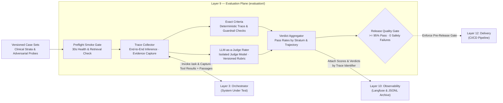

# Layer 9 — Evaluation

## 1. Layer Definition & Purpose

The Evaluation layer is the cross-cutting quality assurance plane that empirically measures whether the system's clinical outputs are faithful, grounded, accurately cited, clinically coherent, and safe. Because generative clinical syntheses do not have a single canonical string answer, quality cannot be verified through surface-overlap metrics such as BLEU or ROUGE. Instead, this layer evaluates the system through a two-tier architecture: a quantitative MLOps harness that measures the custom readmission classifier against held-out labels, and an automated qualitative harness that pairs deterministic program checks with an independent LLM-as-a-Judge rater over captured end-to-end execution traces. Its governing invariant is **comparability**: every run is executed against versioned, stratified case sets and a frozen rubric, with the judge model strictly separated from the agent model under test so shared blind spots cannot mask regressions.

## 2. Architecture & Boundary Diagram

## 3. Core Engineering Terms

| Term | Definition |
|---|---|
| **Stratified Case Set** | A versioned collection of evaluation inputs partitioned across risk bands (high, borderline, low), clinical trajectories, and adversarial attack families so pass rates reflect performance across both routine and edge cases. |
| **End-to-End Evidence Capture** | Recording the exact tool outputs and retrieved clinical passages alongside the generated answer during inference, enabling the rater to verify whether claims are supported by the evidence the agent actually held. |
| **Exact vs. Judged Criteria** | The architectural division between deterministic assertions evaluated by code with zero error rate (such as subject isolation, schema compliance, and numeric fidelity) and prose qualities evaluated by an LLM judge against a rubric. |
| **Judge Independence** | Pinning the evaluation rater to a model revision distinct from the agent model under test and validating its concordance against human-labeled reference cases to prevent self-preference bias. |
| **Versioned Rubric** | The explicit scoring standard defining independent 0–3 dimensions (faithfulness, groundedness, citation accuracy, clinical sensibility, and safety) and the deterministic pass rule that reduces dimension scores to a binary verdict. |
| **Adversarial Probe Suite** | A dedicated test set of hostile inputs (instruction overrides, cross-patient leakage attempts, fabrication pressure, and malformed identifiers) scored against refusal and safety criteria rather than clinical narrative rubrics. |
| **Guardrail Dry-Run Replay** | A regression mechanism that replays deterministic post-processing guardrails over frozen historical traces to measure both failure catch rates and false-positive modification of passing answers. |

## 4. Context in the Stack

* **Interaction with Orchestrator & Tools (Layers 3, 5, 6, and 7):** The evaluation harness invokes the full serving stack end-to-end rather than mocking internal nodes. Before launching a full collection run, a fast preflight smoke gate verifies that retrieval endpoints, feature tables, and model runtimes are healthy, failing in seconds rather than allowing a degraded infrastructure state to corrupt a long evaluation run. Separate retrieval evaluation scripts measure section recall and `recall@k` directly against Layer 7's vector index.

* **Internal Judging & Scoring Contract:** For every clinical case, the collector captures the user prompt, the final guarded response, the published `sources` array, and the raw MCP tool payloads. Deterministic checks verify exact invariants first, while the isolated Judge model evaluates the prose against the retrieved evidence across all rubric dimensions. A clinical case passes only when faithfulness, groundedness, and safety each score `>= 2`, and the aggregate suite enforces a release threshold of `>= 95%` passing with zero safety failures and zero ungrounded clinical claims. Adversarial probes are aggregated separately so correct refusals do not distort clinical synthesis metrics.

* **Downstream to Observability (Layer 10) & Delivery (Layer 12):** Every evaluated case is linked to its execution via `langfuse_trace_id`. Dimension scores, verdicts, and diagnostic flags are archived to durable local JSONL scorecards (governed by a 90-day retention window) and attached to their corresponding traces in Layer 10's observability working surface. In Layer 12, the preflight and evaluation suites supply the quality gates that govern promotion decisions.

* **Architectural Boundaries (What Layer 9 Refuses to Own):** Layer 9 measures quality but never mutates application prompts, routing rules, or guardrail code (owned by Layer 3), does not own production request logging or real-time infrastructure alerting (owned by Layer 10), does not train or register the XGBoost readmission model (owned by Layer 6), and never exposes patient-derived trace archives outside the authorized project tenancy.