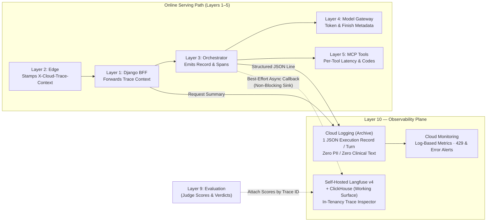

# Layer 10 — Observability

## 1. Layer Definition & Purpose

The Observability layer is the cross-cutting telemetry plane that enables any system execution or production incident to be reconstructed after the fact without reproducing it. Unlike testing or evaluation—which measure how the system behaves on pre-selected cases—observability records what the system actually did on arbitrary live requests, linking every answer back to the exact code revision, foundation model version, custom ML bundle, tool sequence, and latency profile that produced it. Its architecture enforces three foundational invariants: telemetry is split into a durable **Archive** (structured execution logs in Cloud Logging that contain zero patient text or PII) and a rich **Working Surface** (distributed traces in a self-hosted Langfuse stack kept strictly inside the cloud tenancy), monitoring is anchored at the application boundary first before decomposing into per-component spans, and all tracing callbacks operate as non-blocking, best-effort sinks so an observability outage can never fail a clinical request.

## 2. Architecture & Boundary Diagram

## 3. Core Engineering Terms

| Term | Definition |
| ----- | ----- |
| **Execution Record (The Archive)** | A single, schema-pinned structured JSON log line emitted on every turn (success or failure) capturing lineage, timings, token counts, tool names, error codes, and guardrail flags while strictly excluding question or note text. |
| **Working Surface** | A rich, interactive trace inspection environment (self-hosted Langfuse v4 backed by ClickHouse) used to browse multi-step prompt, tool, and passage spans during debugging without moving clinical data outside the cloud project tenancy. |
| **Distributed Trace Context** | The correlation identifier (`X-Cloud-Trace-Context` and `langfuse_trace_id`) stamped at the network perimeter and propagated across the BFF, Orchestrator, and telemetry sinks to join logs and spans into a single causal chain. |
| **End-to-End Lineage** | The attribution metadata recorded on every turn—comprising `code_revision`, requested versus served foundation model ID, custom ML `model_version`, and tool call records—so any output is traceable to the exact artifacts that ran. |
| **Best-Effort Telemetry Sink** | The resilience rule that tracing instrumentation must degrade silently when unconfigured or unreachable, ensuring telemetry collection never introduces availability risk to the serving path. |
| **Application-Boundary Monitoring** | Measuring aggregate request health, end-to-end latency, quota consumption, and HTTP status codes at the user-facing boundary before drilling into internal component spans. |
| **Privacy-Safe Shape Logging** | Recording structural dimensions of an interaction (such as character length, token counts, section names, and guardrail flag identifiers) in durable logs rather than raw user prompts or clinical prose. |

## 4. Context in the Stack

* **Upstream from Serving Layers (Layers 1, 2, 3, 4, and 5):** At the network edge (Layer 2), Google Cloud stamps `X-Cloud-Trace-Context` on every inbound request. The Django BFF (Layer 1) extracts the trace identifier, logs its request outcome, and forwards the header to the Agent Orchestrator (Layer 3). As the orchestrator executes, it collects per-step stage timings, tool execution latencies and stable error codes from Layer 5, and served model versions, finish reasons, safety filter categories, and token counts (input, output, thinking, and cached) from Layer 4. On every exit path—whether normal completion, guardrail rewrite, timeout, or upstream exception—Layer 3 writes one immutable JSON execution record to standard output for collection by Cloud Logging.

* **Separation of Archive and Working Surface:** Because retrieved clinical passages and prompts are sensitive, this layer separates durable compliance logging from interactive debugging. The **Archive** in Cloud Logging stores only privacy-safe metadata and structural shapes, ensuring that tearing down expensive debugging infrastructure never destroys the operational audit trail. The **Working Surface** runs as a self-hosted Langfuse v4 and ClickHouse deployment on private Cloud Run and Compute Engine instances inside the project's own tenancy, receiving LangGraph execution spans asynchronously and returning a `langfuse_trace_id` in the response envelope.

* **The One Place Clinical Text Is Recorded:** The zero-PII guarantee governs the Archive, not the Working Surface, and the distinction is load-bearing rather than rhetorical. `set_trace_io` in `services/agent/observability.py` writes the turn's question and answer into the Langfuse trace's input and output fields, and that is deliberate: a trace stripped of the text cannot answer the question a trace exists to answer — why this answer, to this question, from this patient's retrieved passages. The exception is bounded by where the text lands, not by what it contains. The trace is written to the self-hosted Langfuse instance inside the project's own tenancy, reachable by nothing outside the project. The same text never enters the Cloud Logging Archive: `chain.record_execution` emits no question or answer field, and `trace`/`trace_id` is the identifier that connects the two surfaces without carrying their content. The sink is best-effort, so losing a trace degrades debugging and never the answer. A sink that would leave the tenancy — a hosted Langfuse, an APM that captures request bodies — is a Layer 11 decision about lawful basis, not a configuration change here.

* **Interaction with Evaluation (Layer 9) & Security (Layer 11):** Layer 9 reads the `langfuse_trace_id` emitted by this layer to bind offline and online evaluation verdicts directly to the trace that produced them. Layer 11 defines the data-minimization and zero-PII logging policy (`F6`) that governs what fields `chain.record_execution` is permitted to serialize into the durable archive.

* **Architectural Boundaries (What Layer 10 Refuses to Own):** Layer 10 records and alerts on system behavior but never mutates prompts, tool arguments, or clinical answers (owned by Layer 3), does not store transactional user session state for conversation replay (owned by Layer 8), does not judge clinical narrative quality (owned by Layer 9), and never permits a tracing or logging failure to block or abort a user request.