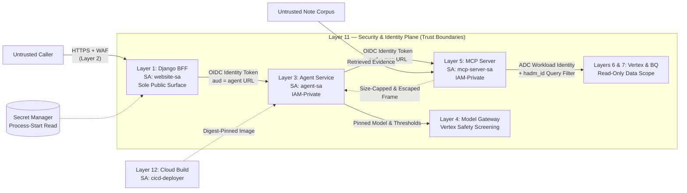

# Layer 11 — Security & Identity

## 1. Layer Definition & Purpose

The Security & Identity layer is the cross-cutting governance plane that enforces trust boundaries, least-privilege workload identities, prompt-injection defenses, data minimization, and software supply-chain integrity across the entire stack. Its core design principle is that **security is a property of enforced boundaries rather than cooperative callers**: every input—whether typed by an authenticated user, returned by a database query, or retrieved from a clinical discharge note—is treated as untrusted. By isolating each microservice behind a dedicated Google Cloud IAM service account, authenticating all service-to-service hops with short-lived OIDC identity tokens, framing retrieved clinical prose inside escaped structural delimiters, and prohibiting raw patient text from entering durable operational logs, this layer ensures that a compromise or adversarial payload in one channel cannot escalate privileges or cross patient boundaries.

## 2. Architecture & Boundary Diagram

## 3. Core Engineering Terms

| Term | Definition |
| ----- | ----- |
| **Trust Boundary** | An explicit architectural seam where control or data crosses between principals with different privilege levels, requiring authentication, schema validation, and sanitization. |
| **Least-Privilege Workload Identity** | Binding each Cloud Run service and build pipeline to a dedicated IAM service account (`website-sa`, `agent-sa`, `mcp-server-sa`, `cicd-deployer`) holding only the minimum permissions required for its role, with zero shared static keys. |
| **Service-to-Service OIDC Token** | A short-lived, cryptographically signed OpenID Connect JWT minted from the Cloud Run metadata server and scoped to a specific target service URL (`audience`), verified by Cloud Run IAM prior to container invocation. |
| **Indirect Prompt Injection Defense** | Protecting the foundation model from instructions embedded inside retrieved clinical notes by wrapping tool outputs in `<tool_result>` tags, escaping embedded closing delimiters, and enforcing post-generation factual guardrails. |
| **Data Minimization & Zero-PII Logging** | Collecting and retaining the minimum clinical data required to serve a turn: excluding note prose from the session database (Layer 8), omitting prompts and answers from Cloud Logging (Layer 10), and restricting public demos to de-identified corpora. |
| **Prompt-as-Code** | Storing all system prompts, routing rules, and safety thresholds in version control under automated test coverage rather than in mutable runtime environment variables or console state. |
| **Supply-Chain Digest Pinning** | Deploying container images and ML serving bundles strictly by immutable SHA-256 content digests built by a dedicated CI/CD identity, preventing mutable-tag tampering. |

## 4. Context in the Stack

* **Perimeter & Identity Boundaries (Layers 1, 2, 3, and 5):** Only the Django BFF (`website-sa`) is publicly reachable behind Layer 2's load balancer and Cloud Armor WAF. Both the Agent Orchestrator (`agent-sa`) and the MCP Tool Server (`mcp-server-sa`) are deployed as IAM-private Cloud Run services that reject unauthenticated network traffic at the platform layer and verify the presence of an `Authorization` header in application code. Secret material (such as the Django signing key) lives exclusively in Google Cloud Secret Manager, is read once at process startup, and never reaches the browser.

* **Data & Prompt Trust Boundaries (Layers 3, 4, 5, and 7):** Because retrieved clinical notes enter the foundation model context window where instructions normally reside, the data path is defended as rigorously as the request path. Layer 5 enforces patient isolation inside the vector query (`hadm_id` namespace filter) and re-verifies note ownership against BigQuery before returning data; any cross-patient mismatch raises an `IsolationViolation` and logs the detail server-side without leaking foreign identifiers to the prompt or caller. Layer 3 caps passage length, escapes `<` and `>` characters so retrieved text cannot close its own `<tool_result>` frame, and runs deterministic post-hoc guardrails (`guard_answer`) to strip ungrounded clinical numbers, medications, or ages. Layer 4 pins explicit Vertex AI safety screening thresholds in code so platform default changes across model generations cannot silently weaken content filtering.

* **Governance & Compliance Across Planes (Layers 8, 9, 10, and 12):** Layer 11 sets the privacy constraints that Layer 8 (7-day conversation purge, citation-identity-only storage) and Layer 10 (shape-only execution logs) implement. Layer 9 continuously tests these boundaries using its 20-probe adversarial suite mapped to OWASP LLM risks (instruction override, cross-patient access, fabrication pressure, and citation integrity), while Layer 12 executes builds under the narrow `cicd-deployer` service account rather than the over-privileged project default compute account.

* **Architectural Boundaries (What Layer 11 Refuses to Own):** Layer 11 defines security invariants and identity bindings across the system but delegates TLS termination and IP rate-limiting execution to Layer 2, user session and quota accounting to Layer 1, post-generation clinical claim verification to Layer 3, and automated pipeline execution to Layer 12.