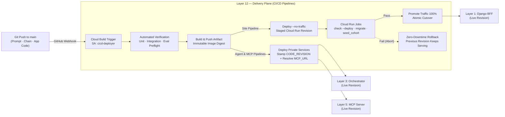

# Layer 12 — Delivery (CI/CD)

## 1. Layer Definition & Purpose

The Delivery layer is the cross-cutting release automation plane that guarantees changes to code, prompts, schemas, and infrastructure reach production safely, identically, and reversibly on every deployment. Its governing architectural principle is that **a delivery pipeline is a quality and safety control whose primary function is to reject broken changes before they receive live traffic**. By declaring all build steps, runtime configurations, and environment bindings as version-controlled code (`cloudbuild.yaml`), executing under a dedicated least-privilege deployer identity (`cicd-deployer`), promoting immutable container artifacts by digest, and ordering database migrations and cohort seeding *before* traffic shifts to a new revision, this layer eliminates manual console drift and ensures that every production revision is provably traceable to a specific Git commit.

## 2. Architecture & Boundary Diagram

## 3. Core Engineering Terms

| Term | Definition |
|---|---|
| **Pipeline as Control** | Designing the CI/CD workflow as an automated enforcement gate where a failing test, broken migration, or failed preflight check halts promotion before user traffic is affected. |
| **Build Once, Promote by Digest** | Compiling a container image once per commit and referencing it by its immutable `@sha256` digest across staging verification and traffic promotion so tested bytes never diverge from deployed bytes. |
| **Staged No-Traffic Deployment** | Creating a new Cloud Run revision with `--no-traffic` so infrastructure readiness, schema migrations, and smoke checks can execute against the candidate revision while the previous revision continues serving 100% of live traffic. |
| **Pre-Promotion Schema Migration** | Executing Django deployment checks (`check --deploy`), database schema migrations (`migrate`), and cohort synchronization as blocking Cloud Run Jobs *prior* to shifting traffic, preventing new application code from running against an unmigrated database. |
| **Configuration as Code** | Declaring all service flags, scaling bounds (`--min-instances`, `--max-instances`), secret bindings, and revision stamps inside committed `cloudbuild.yaml` manifests so services rebuilt from the repository never rely on manual console state. |
| **Least-Privilege Deployer Identity** | Binding Cloud Build triggers explicitly to a narrow service account (`cicd-deployer`) rather than the project's default compute service account, restricting pipeline authority strictly to image push, service deployment, and log writing. |
| **Atomic Revision Rollback** | Reinstating a prior known-good Cloud Run revision by shifting traffic back to its immutable revision name (or leaving `--no-traffic` unpromoted on failure) without rebuilding source code. |

## 4. Context in the Stack

* **Interaction with Application & Service Layers (Layers 1, 3, and 5):** Three independent Cloud Build pipelines govern the serving fleet: the **Site pipeline** (Layer 1 Django BFF), the **Agent pipeline** (Layer 3 Orchestrator), and the **MCP pipeline** (Layer 5 Tool Server). The Site pipeline builds the container image, deploys a dark revision (`--no-traffic`), executes `manage.py check --deploy`, runs PostgreSQL migrations, seeds the authorized patient cohort from the Layer 7 artifact, and promotes the revision to `100%` traffic only after every job succeeds. The Agent pipeline resolves the live `MCP_URL` dynamically from the deployed Layer 5 service and stamps `$COMMIT_SHA` into `CODE_REVISION` so every execution record in Layer 10 carries exact Git provenance.

* **Interaction with Offline MLOps & Index Pipelines (Layers 6 and 7):** While Layer 12 governs application container delivery, it shares the same blue/green, measure-before-promote philosophy implemented in Layer 6 (`deploy_cpr.py` zero-traffic mount and synthetic identity probe) and Layer 7 (`deploy_rag.py` staging index mount and mandatory `recall@10` gate). Across all three subsystems, no artifact takes live traffic until its precondition gate passes.

* **Interaction with Evaluation, Observability & Security (Layers 9, 10, and 11):** Layer 9 defines the unit, contract, and preflight evaluation suites that act as pre-deployment gates in CI, as well as the capacity and load-testing baselines required before production traffic scaling. Layer 10 consumes the `CODE_REVISION` and Cloud Run revision identifiers stamped by this layer to correlate latency or error regressions with specific deployments. Layer 11 governs the `cicd-deployer` IAM bindings and image supply-chain controls enforced during build and admission.

* **Architectural Boundaries (What Layer 12 Refuses to Own):** Layer 12 automates build, verification, migration ordering, and traffic promotion, but does not author clinical evaluation rubrics (owned by Layer 9), does not manage runtime OIDC request authentication (owned by Layer 11), does not fit ML model weights or build vector indexes on push triggers (owned by Layers 6 and 7), and never mutates production configuration outside version-controlled build manifests.