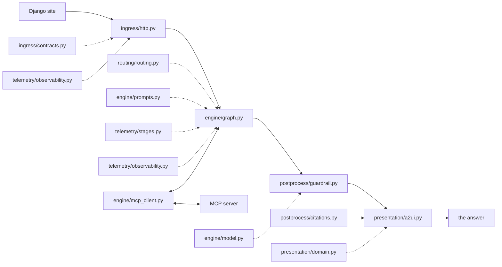

# `services/agent` — the clinical copilot's reasoning service

The diagram is the request path, read left to right. The main line is the sequence a question
passes through; the modules hanging off it are what each step calls. The **record** sits off
the path on purpose — one line is written for every run, including the ones that never reach
an answer.

## Modules

| Module | What it is for |
|---|---|
| `ingress/http.py` | The service surface: two routes, one answer and one stream, plus a health check. Owns the deadline and the per-request tool session. |
| `ingress/contracts.py` | The request and response contracts. Refuses anything outside the agreed shape, before a model runs and after. |
| `routing/routing.py` | The wording of the question: a chip or a typed sentence becomes the text the model is asked. |
| `engine/graph.py` | The run itself: the model turns to choose a tool, the tool runs, the model turns again to narrate the result. |
| `engine/prompts.py` | The system prompt, and with it the rules the model runs under. |
| `engine/mcp_client.py` | The bridge to the tool server, presenting its tools to the model as ordinary tools. |
| `telemetry/stages.py` | Progress: what the run is doing, turned into the events a waiting caller sees. |
| `engine/model.py` | How a turn ended — tokens, serving model, safety filters, and the reason an answer was cut short. |
| `guardrail.py` | The deterministic checks after the model writes. The model proposes; this decides what may be served. |
| `citations.py` | Citation reconciliation: the model's markers are renumbered against the passages actually retrieved and resolved to note sections. |
| `a2ui.py` | The presentation adapter. Composes the canvas, the source list and the literature from the guarded answer and the tool evidence. |
| `feature_labels.py` | The one place a model feature is named, so the chart and the prose beside it cannot disagree. |
| `chain.py` | The chain's identity and its record: which model, which revision, one line per execution. |
| `observability.py` | Tracing as a sink, never a dependency. The service runs unchanged when it is switched off. |
| `run.py` | The developer entry point for asking a question by hand. Not part of the request path. |
