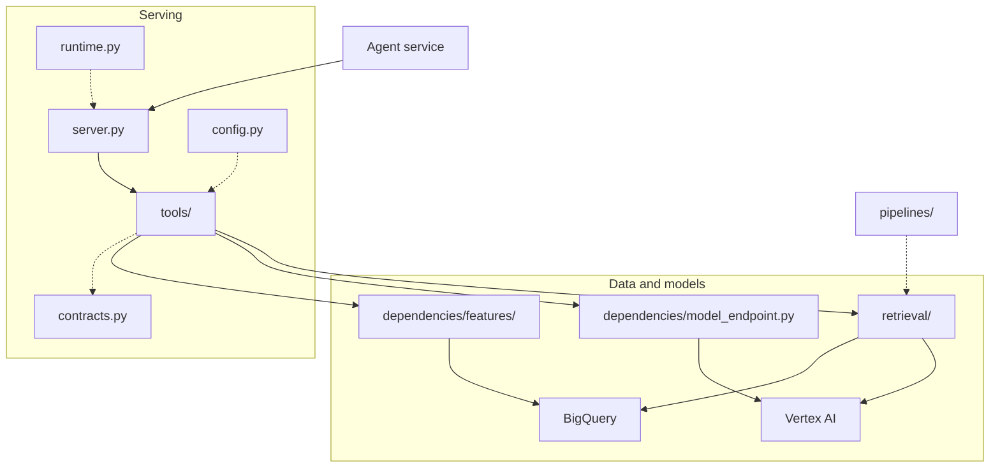

# `services/mcp` — the clinical copilot's tool server

The diagram represents the tool calls and boundaries for 4 tools:
1. Calling a risk model
2. Deterministic EHR notes retrieval
3. RAG EHR notes retrieval
4. Integration with Pubmed for retrieval of medical literature 
 
Risk model was developed in house using [MLOPs](../../mlops/README.md) pipeline on `Gemini Enterprise` (formerly Vertex AI)  
Data ingestion, chunking, embeddings, automated through pipelines on `Gemini Enterprise` 
Vector db, vector index and index endpoints are built and deployed using on `Gemini Enterprise` 
Integration with Pubmed is initated through `langchain-community` library 
ML Training dataset and rag corpus used for Vector Search was developed using `mimic-iv` dataset 
Public consumption of the dataset is prohibited, so a demo dataset from `MTSamples` was used with real EHR clinical discharge notes 
Structured data for the demo cohort is synthetic

## Serving

| Module | What it is for |
|---|---|
| `server.py` | The server itself: registers the tools and speaks the protocol over stdio or HTTP. |
| `tools/prediction.py` | Scores one admission and returns the factors behind the score. |
| `tools/retrieval.py` | The note tools: relevance search, section retrieval, and the discharge medication list. |
| `tools/literature.py` | Searches PubMed and returns citable records. |
| `tools/_validation.py` | One definition of a valid admission id, applied by every tool. |
| `contracts.py` | Validators for what each tool returns. A malformed result is an error, never an answer. |
| `config.py` | The names and the numbers: project, region, tables, index. One place to change them. |
| `runtime.py` | What the agent service and this one must agree on: authentication, and how long each step may take. |

## Dependencies

| Module | What it is for |
|---|---|
| `dependencies/features/base.py` | The seam: what a feature source must provide, independent of where features come from. |
| `dependencies/features/bigquery_source.py` | The feature source in use — production, CI, and development alike. |
| `dependencies/features/manifest.py` | Which serving bundle decides the order the model expects its features in. |
| `dependencies/model_endpoint.py` | A cached handle on the deployed prediction endpoint. |

## Retrieval

| Module | What it is for |
|---|---|
| `retrieval/sections.py` | Parses a discharge note into its named sections. |
| `retrieval/chunking.py` | Splits those sections into the citable passages the index stores and retrieval returns. |
| `retrieval/embed.py` | Turns text into the vector the index holds. |
| `retrieval/config.py` | The retrieval settings as code: corpus, chunking, index, evaluation, deployment. |
| `retrieval/notes.py` | A local cache of the note corpus, so repeated probes do not re-read it each time. |
| `retrieval/concepts.py` | Clinical concept tagging with assertion handling. Runs in its own environment. |
| `retrieval/source_fingerprint.py` | A digest of the source tables, so every artifact can name the data it was built from. |
| `retrieval/gate.py` | Turns a recall report into a pass or a fail. |
| `retrieval/eval_report.py` | Builds that report. |

## Build path

Offline, and never on the serving path. These produce the index the retrieval modules query.

| Module | What it is for |
|---|---|
| `pipelines/rag_ingest_pipeline.py` | The ingest DAG: notes in, a deployed index out. |
| `pipelines/components/chunk_notes.py` | Reads the discharge notes and chunks them. |
| `pipelines/components/embed_chunks.py` | Embeds the chunks into the index artifact. |
| `pipelines/components/eval_ingest.py` | An integrity gate on the artifact, before anything is deployed. |
| `pipelines/components/build_index.py` | Creates and deploys the Vector Search index. |
| `pipelines/components/_image.py` | The container image the pipeline components run in. |
| `pipelines/recall_k.py` | Measures retrieval agreement over the whole corpus, in the cloud. |
